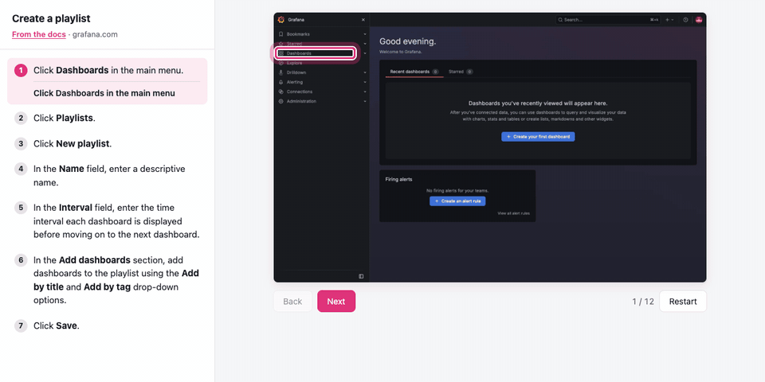
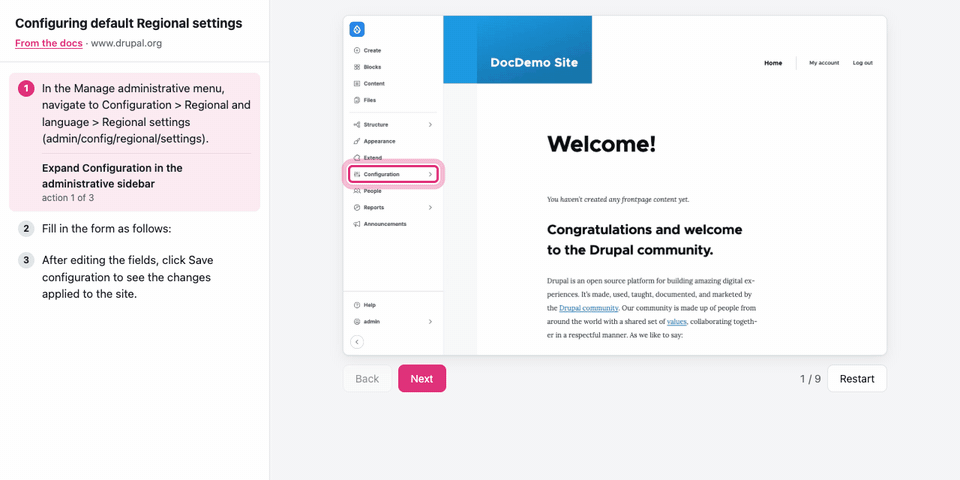
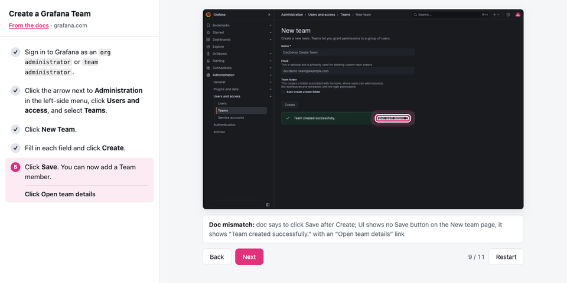

# DocDemo

**Docs that click: turn a how-to page into a clickable demo of your product.**

Give DocDemo the link to a documented procedure and the URL of your app. It follows the steps in a real
browser and gives you an interactive walkthrough in which every step quotes your doc. Technical writers can
put it on the doc page, and support teams can send it to a customer instead of a link to the doc.

Along the way, it answers a question that matters more as AI agents read your docs: **can an agent follow
them?** Where it can't follow the doc as written (a renamed button, a moved menu, a step that no longer
works), it tells you which step and why.

[](https://serendip-ai.github.io/docdemo/grafana-create-playlist/)

This demo was made from Grafana's
[Create a playlist](https://grafana.com/docs/grafana/v13.2/visualizations/dashboards/create-manage-playlists/#create-a-playlist)
doc and a local copy of Grafana OSS 13.2.2, with one command. [Click through it yourself](https://serendip-ai.github.io/docdemo/grafana-create-playlist/). More examples:
[Create a dashboard folder](https://serendip-ai.github.io/docdemo/grafana-create-folder/), [Create a team](https://serendip-ai.github.io/docdemo/grafana-create-team/review.html)
(with doc mismatches), Drupal's [Configuring default Regional settings](https://serendip-ai.github.io/docdemo/drupal-regional-settings/review.html)
(pick from dropdowns, with doc mismatches), or see [all examples](https://serendip-ai.github.io/docdemo/), including one embedded the way it would be on a doc
site.

In Drupal's demo, the viewer picks each value from the real dropdowns, and DocDemo flags the two places
where the Drupal User Guide and Drupal 11 disagree:

[](https://serendip-ai.github.io/docdemo/drupal-regional-settings/)

## What you get

- **An interactive demo of your doc.** Each step shows the real screen, a hotspot on what to click, and
  the doc sentence it comes from. Where the doc says to enter or choose a value, the viewer types it in
  or picks it from the list.
- **Ready for your doc site.** The demo is a small static page (about 400 KB for 12 steps) with an
  embed mode, and DocDemo prints the `<iframe>` snippet to paste into your doc.
- **Alerts when the doc and the product disagree.** If a button was renamed, a menu moved, or a step no
  longer works, DocDemo tells you as it runs and writes `report.md`, a step-by-step list of every
  discrepancy.
- **Checks what the doc says beyond its steps.** A sentence that says what the product does (a
  default, a limit, a sort order, what a setting changes) is checked in the app too, without changing
  anything saved. `report.md` gives each one a verdict, with the screenshots it rests on; readers never
  see them.
- **Product errors, with the HTTP error behind them.** If the app itself fails during a step (a server
  error, a request that fails, an error page), `report.md` says so, separately from the doc's errors,
  with the HTTP status and the request from the browser's network log.
- **Your doc is the script.** There is nothing to record and no test to write. DocDemo reads the
  published page and refuses any step that is not a word-for-word quote of it.
- **Works with web apps.** Anything that runs in a browser, including apps on localhost and apps
  behind a login. Desktop and mobile apps are not supported.

## Make a demo

Requirements: macOS or Linux, [Claude Code](https://code.claude.com), Node 20+, and Google Chrome. DocDemo
doesn't run on Windows yet.

**Use a test instance and a test account.** DocDemo performs the doc's steps for real, so anything the
procedure creates, changes or deletes really happens in your app. Readers see the screenshots, so make
sure the account shows nothing private. Claude also reads every page it opens, and text on a page could
try to steer it, so use DocDemo only with docs and apps you trust.

1. Install DocDemo (once):

   ```bash
   npm i -g @playwright/cli@0.1.21       # the browser driver DocDemo uses
   ```

   Then, in Claude Code:

   ```
   /plugin marketplace add serendip-ai/docdemo
   /plugin install docdemo@docdemo
   ```

2. Ask for a demo: the doc's URL, then your app's URL. Link to the doc's heading (`#...`) when the page
   has more than one procedure.

   ```
   /docdemo:docdemo https://docs.example.com/projects/#create-a-project http://localhost:8080
   ```

3. Open `demo/review.html`: the demo with DocDemo's notes on the steps where the doc and the product
   disagree. `demo/report.md` lists those discrepancies, along with the snippet for putting the demo on
   your doc page. `demo/index.html` is the same demo without the notes: that's the one your readers get.

A short procedure takes a minute or two. In the 1.4.0 benchmark, procedures of 3 to 7 steps took 44 to 95
seconds each and cost $0.38 to $0.81 at API prices, on the model DocDemo uses (Claude Opus, at low
effort). On a Claude plan, a run counts toward your plan's usage instead.

Each new run starts a fresh `./demo/` and keeps the previous demo beside it, as
`./demo.prev-<date>-<time>/`, so notes you edited are never lost. If `./demo/` holds anything else, or
wasn't made by DocDemo, DocDemo stops instead of touching it.

To correct what a frame says (a caption that names the wrong button, a note to reword), ask Claude, or run
the helper's `amend` command yourself: `amend --frame 7 --instruction "Click Save dashboard"` (or
`--note "..."`, or `--clear-note`). The frame number is the screen number in `review.html`. `amend` changes
only that text and builds the demo again; the screenshots, actions and check results stay as recorded, and
the previous `demo.json` is kept in `demo/.debug/amend/`.

No Chrome? Run `playwright-cli install-browser chromium`; DocDemo falls back to it automatically.

### If your app needs a sign-in

Sign in once, by hand:

```
/docdemo:login http://localhost:8080
```

A browser window opens at your app. Sign in the way you normally do (single sign-on and 2-factor work),
then close the window. DocDemo saves the session to `docdemo-auth.json` in the current folder, and every
run started from that folder begins signed in. Claude never sees or types your password.

If a run reports that the app shows a sign-in page, the session has expired: run `/docdemo:login` again.

`docdemo-auth.json` holds your session cookies, so keep it out of version control: add it to
`.gitignore`. DocDemo warns you if git would commit it.

**Or use a test account.** Put its credentials in a `.env` file in the folder you run Claude Code from
(or set them as environment variables):

```
DOCDEMO_USERNAME=demo@example.com
DOCDEMO_PASSWORD=your-test-password
```

When a run lands on the sign-in page, DocDemo signs in with them. Claude only points at the fields; the
helper script reads `.env` and types the values, and the sign-in is not part of the demo. The helper types
the credentials only on your app's own address (the scheme, host and port you gave DocDemo) and the
password only into a real password field. It clears the password from the page afterwards, even when
the sign-in fails or the page shows the password as plain text. If your sign-in page is on another host, such as a separate single sign-on server,
use `/docdemo:login`. While DocDemo runs,
its skills block Claude's Read tool from opening `.env` and `docdemo-auth.json`; to block it in every
session, add `"Read(./.env)"` to `permissions.deny` in your Claude Code settings. Neither stops a shell
command from reading the file. If the password must never be readable on your machine, use
`/docdemo:login` instead: it stores no password at all. The `.env` option doesn't work with single
sign-on or 2-factor either. Add `.env` to `.gitignore` too.

### Try it on a sample app

Needs Docker. This starts a throwaway, seeded Grafana on localhost and saves a signed-in session:

```bash
git clone https://github.com/serendip-ai/docdemo && cd docdemo
./fixtures/grafana/up.sh
./fixtures/grafana/auth.sh docdemo-auth.json
```

Then start Claude Code in that folder and run:

```
/docdemo:docdemo https://grafana.com/docs/grafana/v13.2/visualizations/dashboards/manage-dashboards/#create-a-dashboard-folder http://localhost:3000
```

## Add a demo to your docs

Host `index.html` and `assets/` with your doc site or on any static host; nothing else in `demo/` is
needed. `index.html` holds only what readers see: the doc's steps, the screenshots and the actions.
DocDemo's notes, your app's address and the recorded locators stay in `review.html`, `report.md` and
`demo.json`, so don't publish those. Then embed it on the doc page. DocDemo prints the snippet when it finishes:

```html
<iframe src="/demos/create-a-playlist/index.html?embed" title="Interactive demo: Create a playlist" width="100%" height="560" style="width:100%;height:auto;aspect-ratio:4/3;border:0" loading="lazy"></iframe>
```

Change `src` to wherever you host the demo, or tell DocDemo up front and it fills it in
(`build --embed-url https://docs.example.com/demos/create-a-playlist/`).

Readers see the doc's steps under its own headings, with the code a step points at ready to copy, and can
click a step to go to it. Clicks into a field, or selecting its text, before typing in it are folded into the
typing screen (`review.html` keeps them). To open with an introduction and end with what the reader
accomplished, add these to `demo.json` and run `build` again:

```json
"intro": "This walkthrough follows ... You explore ... and build ...",
"introNote": "The screenshots show version 13.2. Where they differ from the steps, follow the caption.",
"outro": "You queried the sample app and saved a dashboard."
```

The intro screen also tells readers it is a guided simulation with nothing to install. Without an `outro`,
the end screen simply says the walkthrough is over; the run's numbers stay in `review.html` and
`report.md`.

`?embed` hides the demo's own step list (the doc page already has the steps), shows the current step
under the screenshot, and fits the demo to any iframe size. Add `&theme=light` or `&theme=dark` to
match your site instead of the reader's system setting. The demo's step number lives in the iframe's
own URL, so your doc page's URL never changes.

| Platform | How | Status |
| --- | --- | --- |
| Hugo | Put the demo under `static/demos/...` and use a shortcode (below). A raw `<iframe>` in Markdown is removed unless `markup.goldmark.renderer.unsafe` is on. | Tested (Hugo 0.167) |
| Docusaurus | Put the demo under `static/demos/...` and use the MDX snippet DocDemo prints: in MDX, `style` must be an object, and the HTML snippet fails the build. | Tested (Docusaurus 3) |
| MkDocs | Put the demo folder inside `docs/` and paste the HTML snippet. | From the docs |
| ReadMe | Use the MDX snippet, or wrap the HTML snippet in `<HTMLBlock>`. | From the docs |
| Mintlify | Use the MDX snippet. | From the docs |
| Confluence Cloud | Type `/iframe`, paste the demo URL, and set a height (for example 560). The macro takes a URL and a fixed size only. | From the docs |
| Confluence Data Center | Paste the HTML snippet into an HTML macro (an admin has to enable the macro first). | From the docs |
| Zendesk Guide | Paste the HTML snippet; an admin has to turn on **Display unsafe content** for iframes from your host. | From the docs |
| GitBook | Not supported: GitBook embeds only URLs from its supported providers. | From the docs |

Hugo shortcode, saved as `layouts/_shortcodes/docdemo.html` (`layouts/shortcodes/` before Hugo 0.146):

```go-html-template
<iframe src="{{ .Get "src" | relURL }}index.html?embed" title="Interactive demo: {{ .Get "title" }}" width="100%" height="560" style="width:100%;height:auto;aspect-ratio:4/3;border:0" loading="lazy"></iframe>
```

In a page: ``

## When the doc and the product disagree

DocDemo checks each step against the live product: every term the doc marks as UI text (bold, code,
quotes) and every phrase about where something is ("in the navigation bar", "top right"). When
something doesn't match:

- **The doc is wrong** (a renamed button, a moved menu, a step that no longer exists): DocDemo performs
  the step the way the product actually works, so you still get a complete demo, and marks that step
  with a **Doc mismatch** note.
- **The difference comes from how your instance is set up** (a feature that isn't enabled, an empty
  list): the note says **Depends on setup**, and it is listed separately so it isn't mistaken for a
  doc error.
- **The step works but is worded loosely** ("Save your changes" for a button labeled **Save contact
  point**): the note says **Wording to tighten** and gives the label the UI shows. It isn't counted
  as a doc error.
- **The step can't be performed at all:** the demo ends at that step with a red banner explaining why.
- **The product itself fails** (a server error, a request that fails, an error page): that isn't the
  doc's fault, so `report.md` lists it under its own heading, with the HTTP errors from the browser's
  network log for that step.



Every finding shows up on its step in `review.html`, in the terminal when the run finishes, and in
`report.md`, a step-by-step list you can hand to whoever owns the doc. For example:

```markdown
## The doc and the product disagree (2)

- **Step 3:** Click **New Project**.
  - doc says "New Project"; UI shows "New project"
- **Step 5:** Click **Save**.
  - doc says to click Save; UI saves on Create and shows no Save button
```

And when the product fails:

```markdown
## The product returned errors (1)

The HTTP errors are from the browser's network log while DocDemo performed the step.

- **Step 4:** Click **Save dashboard**.
  - saving fails; the page says "Internal server error"
  - HTTP 500 Internal Server Error: POST /api/dashboards/db ("database is locked")
```

## What's in a demo

```
demo/
  index.html     the demo for your readers: open it in a browser (works from file:// and any static host)
  review.html    the same demo with DocDemo's notes on each finding, for you
  assets/        one 1440×900 WebP screenshot per frame
  evidence/      screenshots for the claims beyond the steps, shown only in review.html (when there are any)
  report.md      every place the doc and the product disagree, errors the product returned, and the embed snippet
  demo.json      title, doc URL, the doc's steps, and one frame per action (image, hotspot, locator); also
                 a procedure id, a hash of the doc's steps, the app version if given, and the run's counts
  source.md      the fetched doc
  steps.json     the documented steps, copied from the doc
```

## How it works

```
doc URL ──▶ helper fetches the doc (as markdown when the site offers it)
        ──▶ Claude picks the procedure's numbered list; the helper copies its steps, verbatim
app URL ──▶ for each documented step:
              Claude reads the page's accessibility snapshot and picks the element(s)
              helper runs ONE browser call: settle → check the element → screenshot → act,
              noting the HTTP errors in the network log, and prints the next snapshot
              helper checks the step's UI terms and locations against the page;
              Claude answers every one that does not match
        ──▶ helper validates everything and writes demo/index.html and demo/report.md
```

Claude does the reasoning. A small zero-dependency script
([`skills/docdemo/scripts/docdemo.mjs`](skills/docdemo/scripts/docdemo.mjs)) does everything that must
be exact: it is the only way the skill touches the browser, so every action is captured, and its
`build` step refuses a demo whose step text is not a verbatim quote of the doc, or that leaves a check
unanswered, so no check is skipped. Runs still vary: Claude may word a finding differently, or report it
on the step after the one that is wrong.

## How well it works

Tested on five open-source web apps: Grafana, Metabase, n8n, Mattermost and Forgejo (see `bench/`).

- In a 10-procedure sample (2 from each app), every run produced a complete demo.
- In planted-error tests (`bench/run.mjs --mutants`), 39 errors were added to docs for Grafana,
  Forgejo and Metabase: renamed buttons, outdated terms, wrong menu paths, nonexistent fields, missing
  or reordered steps, and wrong locations. DocDemo reported 38. The miss was a claim about behavior
  that the UI does not show.
- Version 1.3.0 ran the Grafana part twice: 13 planted errors in 6 procedures, plus the 6 unedited docs,
  19 runs each time. Both times DocDemo reported all 13 planted errors, 12 on the step with the error and
  one on the step after it, where the wrong menu left the next step stranded. On the unedited docs, both
  runs reported the same three real mismatches with Grafana 13.2.2 and nothing else. 36 of the 38 runs
  produced a complete demo; in the other two, Claude stopped the demo at a real error instead of noting
  it and going on. A run took about a minute.
- Version 1.4.0 ran it once more, taking each procedure's steps from the doc's own numbered list: again
  all 13 planted errors (the same one a step late), Grafana's three real mismatches and nothing else on the
  unedited docs, and 18 of 19 runs complete, in 1,386 seconds for the 19 runs. In 12 of them Claude also
  checked one or two claims beyond the steps, from screens the run had already recorded.
- It also flagged real errors in the published docs, such as a step that says "click the icon"
  without saying which icon.

## Limitations

- Web apps only, and the app must be reachable from your machine (localhost is fine). DocDemo runs in
  Claude Code on your own machine, on macOS or Linux.
- One procedure per demo. DocDemo follows the doc; it does not crawl the product.
- Apps work best when their UI has a reasonable accessibility tree; icon-only buttons without labels,
  canvas charts, file uploads and drag-and-drop are the usual trouble spots.
- Doc fetching prefers a site's `.md` pages and falls back to a simple HTML-to-text pass.
- Claims beyond the steps: DocDemo checks up to three per run, and only in ways that change nothing saved
  (sorting, filtering, opening, hovering). A claim it can't show that way is listed as not verified, with the
  reason, rather than guessed.
- Native browser dialogs (a `confirm()` box) are not in the screenshots: DocDemo accepts one that an
  action opens, as a reader would (or cancels it, when the doc says to), and the demo shows the page
  before and after it.
- If your Claude Code settings enable `permissions.blockReadsOutsideWorkingDirectories`, the skill
  cannot run its helper script; allow the plugin's folder with `/add-dir` (for example
  `/add-dir ~/.claude/plugins/.../skills/docdemo`) and run the command again.

## FAQ

**Does every demo need a Claude run?** Yes, for now. Each action records a stable Playwright locator for
the element it acts on, so a later version can replay a demo without an LLM, for example in CI.

**Does it work outside Claude Code?** Not yet. DocDemo is a Claude Code plugin, and its skill and helper
haven't been tried with other agents.

**How is DocDemo different from Doc Detective?** Doc Detective turns docs into test specifications and
reports which steps pass or fail. DocDemo turns a doc into a walkthrough your readers click through, and
a report on where the doc and the product disagree.

## Development

```bash
npm test                              # drives the helper against a local mini app (no LLM needed)
node bench/run.mjs --dry-run          # list the benchmark's documented procedures
node bench/run.mjs --app grafana      # run the real skill on each Grafana procedure (uses Claude)
node bench/run.mjs --mutants          # plant known errors in the docs and score which ones are caught
docs/make-gif.sh examples/grafana-create-playlist docs/demo.gif 4   # re-record the README's previews
docs/make-gif.sh examples/drupal-regional-settings docs/demo-drupal.gif 2
```

The benchmark (`bench/run.mjs`) runs the skill once per documented procedure on a freshly reset
instance of each app in `fixtures/`, then writes `bench/runs/<id>/summary.md` with every reported
mismatch listed for labeling as real, false, or an agent error.

## Support

DocDemo is free. If it saves you or your team time, you can
[buy me a coffee](https://buymeacoffee.com/docdemo).

## Contributing

DocDemo is not accepting outside contributions yet. Bug reports and feedback are welcome in
[Issues](https://github.com/serendip-ai/docdemo/issues).

## License

Copyright 2026 Serendip AI. Licensed under the [Apache License 2.0](LICENSE); see [NOTICE](NOTICE)
for third-party material.

DocDemo is an independent project. It is not affiliated with, sponsored by or endorsed by the makers
of any product named here: the apps in its examples and benchmark (Grafana, Drupal, Forgejo, Mattermost,
Metabase and n8n), the tools it runs on (Claude Code, Playwright, Google Chrome, Chromium, Node.js, npm
and Docker), or the doc platforms, services and tools mentioned above (Hugo, Docusaurus, MkDocs, ReadMe,
Mintlify, Confluence, Zendesk Guide, GitBook, GitHub, Buy Me a Coffee and Doc Detective). Product names
are trademarks of their respective owners. Drupal is a registered trademark of Dries Buytaert.

The example demos and the benchmark fixtures quote short passages from the documentation of Grafana,
Drupal, Forgejo, Mattermost, Metabase and n8n, with links to the original pages. Those passages remain
the property of their owners: the Grafana documentation belongs to Grafana Labs, and the Drupal User
Guide is © its contributors under [CC BY-SA 2.0](https://creativecommons.org/licenses/by-sa/2.0/). The
example screenshots show Grafana OSS 13.2.2 and Drupal 11.4.8.
